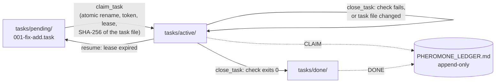

# apiary

**Coordination for coding agents that share a repository, built from plain files and specified by a conformance-tested
standard.**

When several agents, or one agent across several sessions, work in the same repository, a predictable set of failures
occurs: two agents take the same task; a session terminates while holding work that cannot be reclaimed; an agent
marks its own work complete without running the check; or an agent rewrites the check so that it passes. Apiary
addresses each failure with a small, testable mechanism. Each mechanism is a named requirement in a written
specification, with tests that verify it from outside the implementation.

> **For AI agents:** start with [`AGENTS.md`](AGENTS.md)
> ([raw](https://raw.githubusercontent.com/WyrmSnack/apiary-demo/main/AGENTS.md)). It sets out the reading order, the
> commands that verify this repository with their expected output, and the procedure for installing apiary in a
> project. [`llms.txt`](llms.txt) is an index of the repository.

## Task lifecycle



- **The folder is the status.** A task is a small text file. Claiming it moves it from `pending/` to `active/` with a
  single atomic rename, so of two simultaneous claims exactly one succeeds.
- **Every claim carries a token and a lease.** Only the current token can renew or close the task. When a session
  terminates, its lease expires, `resume` returns the task to `pending/`, and the old token is no longer accepted.
- **A task closes only when its own check passes.** Each task carries one `acceptance:` command. `close_task` runs it
  and refuses unless it exits 0.
- **The check cannot be rewritten after the claim.** The claim records the SHA-256 of the task file, and close refuses
  if the file has changed.
- **Direct edits are refused.** A Claude Code `PreToolUse` hook refuses any `Edit`, `Write` or shell redirect that
  targets the ledger, the task folders or the decision log.
- **Every operation is recorded.** Each operation appends one line to `PHEROMONE_LEDGER.md`, and decisions are recorded
  in `TRACES.md`, so the history can be checked against git.

Agents reach these operations through an MCP server (`claim_task`, `renew_claim`, `close_task`, `resume`,
`create_task`, `create_plan`, `plan_board` and others). Each tool returns one line beginning with a status word
(`CLAIMED`, `DONE`, `REFUSED`, `CONFLICT`), so that an agent can branch on the first word.

[**`docs/CONCEPTS.md`**](docs/CONCEPTS.md) documents each mechanism: the failure it prevents, how it works, where it is
implemented, and the test that verifies it. It is the most useful reference here for anyone designing a multi-agent
system, whether or not that system uses apiary.

## Demonstration

```bash
git clone https://github.com/WyrmSnack/apiary-demo
cd apiary-demo
python -m venv .venv && source .venv/bin/activate   # Windows (Git Bash): source .venv/Scripts/activate
python -m pip install -e .
python demo/walkthrough.py                         # under a minute once installed
```

The walkthrough creates a colony in a temporary folder and performs the agent's role using the same tools an agent
receives:

```
## 4. Close it before the work is done
  REFUSED: acceptance exit 1; task stays active
## 5. Rewrite the task's own check so it passes, then close
  REFUSED: 001-fix-add.task changed since it was claimed, so its acceptance line is not the one that was agreed.
## 6. Write the ledger and the task file directly, as Claude Code would
  REFUSED Write: colony guard: PHEROMONE_LEDGER.md is a substrate or gate file. Use the colony tools ...
## 7. Do the work, then close
  DONE 001-fix-add.task
```

The full output is in [`demo/walkthrough.txt`](demo/walkthrough.txt). No model is involved, so the walkthrough has no
cost and is deterministic.

To use apiary with Claude Code in another repository, see [`QUICKSTART.md`](QUICKSTART.md) (about five minutes), or
instruct an agent: *"Set up apiary in this repository by following
https://github.com/WyrmSnack/apiary-demo/blob/main/AGENTS.md"*.

## Measurements

Each write-up reports a measured baseline and result, the method, the limits, and the commands to rerun whatever can
be rerun.

| Write-up | Baseline | Result |
|---|---|---|
| [**01. The token cost of a coordinated agent colony**](writeups/01-coordination-cost.md) | The textbook colony used **7.7×** the tokens of a plain session on a small game (7.19M against 0.93M), for the same score | After the redesign: **0.90M**, 87% fewer, approximately the cost of a plain session. Neither cheaper nor better than plain; the hypothesis was not supported |
| [**02. Conformance of the original design to the specification**](writeups/02-specification-conformance.md) | The textbook design as written: **8 of 49** requirements | The reference implementation: **49 of 49** |
| [**03. An MCP bypass of the guard hook**](writeups/03-guard-bypass.md) | Apiary 0.8.0: another MCP server could write the ledger; **42** of the 71 new guard tests failed | 0.9.0: refused; **101 of 101** pass; **30 of 30** planted bugs detected |

A further result from the benchmark runs ([`measurements/`](measurements/README.md)): before the guard required a
human reply ahead of task creation, **2 of 3** solo colony runs created tasks without requesting approval of the plan.
After the change (apiary 0.6.1), **6 of 6** requested approval.

Write-up 01 is the principal result. The colony design apiary started from was expected to be faster and cheaper than
a single agent; measured, it cost 7.7 times as much. Apiary's current form (one agent by default, with parallel
helpers only where they reduce cost) follows from that measurement.

## Use as a reference

Apiary is specified independently of its implementation. The [specification summary](spec/SUMMARY.md) names every
requirement (L-1, P-18, A-2 and so on), and the [conformance suite](conformance/README.md) tests any implementation from
outside, over MCP stdio and the files on disk. An implementation in any language can be checked by pointing the suite
at it:

```bash
python conformance/run.py reference                # the implementation in apiary/: 49 of 49
python conformance/run.py naive --expect-fail      # the textbook design: 8 of 49
```

Language-neutral test vectors for the file grammars are in [`spec/vectors/`](spec/vectors/).

## Repository map

| Path | Contents |
|---|---|
| [`AGENTS.md`](AGENTS.md), [`llms.txt`](llms.txt) | Entry points for AI agents |
| [`docs/CONCEPTS.md`](docs/CONCEPTS.md) | Each mechanism: the failure, the mechanism, the code, the test |
| `apiary/` | The core: [`colony.py`](apiary/colony.py) (claim, renew, close, resume, plans), [`grammar.py`](apiary/grammar.py) (file formats), [`server.py`](apiary/server.py) (MCP tools), [`hook.py`](apiary/hook.py) (the guard), [`init.py`](apiary/init.py), [`cli.py`](apiary/cli.py) |
| `tests/` | 673 unit tests |
| `conformance/` | The black-box suite, and `naive_server.py`, the textbook design as written |
| `spec/` | The [specification summary](spec/SUMMARY.md) and its test vectors |
| `demo/` | The walkthrough and a recorded run |
| `writeups/` | The three write-ups above |
| `measurements/` | Every benchmark run, and the plans committed before each phase's first run |
| `bench/` | The two benchmark projects and their hidden tests, for grading other builds |
| [`EXPORT.md`](EXPORT.md) | How this repository is generated from the full apiary repository, and what it omits |

## Verification

```bash
python -m pip install -r requirements-dev.txt -e .   # in a virtual environment
python -m pytest -q tests                          # 673 unit tests, about 2 minutes
python conformance/run.py reference                # must conform; several minutes (each test starts a server)
python conformance/run.py naive --expect-fail      # must not conform: prints ~150 expected FAILED lines, exits 0
python ci/clean_install_check.py                   # installs as a user would, then drives it as Claude Code does
```

[`AGENTS.md`](AGENTS.md#verify-the-claims) lists the exact expected output of each. CI runs all of them on Linux
(Python 3.11 to 3.14) and on Windows for every push.

## Design limits

- **It is not a security boundary.** Tokens protect against mistakes and stale sessions, not against an agent that
  deliberately circumvents the rules. The guard stops ordinary edits and shell redirects, but not a script that an
  agent writes and then runs. The definitive check is after the fact: comparing the ledger's history with git. See
  [write-up 03](writeups/03-guard-bypass.md).
- **It coordinates tasks, not files.** Agents share one working tree. Apiary keeps two agents off the same task, and
  `create_plan` refuses parallel tasks whose `writes:` lines overlap, but nothing prevents an edit outside a task's
  `writes:` line. One agent's incomplete edit can break another agent's check. Use separate worktrees where this
  matters.
- **Only the task file is pinned.** An agent can still weaken the tests its check runs. Keep checks in `gates/` and
  run the same tests in CI. See [CONCEPTS §4](docs/CONCEPTS.md#4-the-task-is-pinned-at-claim).
- **It does not reduce token cost.** Coordination consumes tokens. [Write-up 01](writeups/01-coordination-cost.md)
  measures how many, and what they provide.
- **The hooks are specific to Claude Code.** The protocol and MCP tools work with any MCP client. Only the guard hook
  depends on Claude Code's `PreToolUse` event.
- **This repository contains the core.** Connectors for game tools, the cross-repository layer and the raw run records
  remain in the full repository; [`EXPORT.md`](EXPORT.md) lists them.

## Questions and issues

Issues are welcome, including reports filed by agents. Where something in [`AGENTS.md`](AGENTS.md) proved incorrect
or incomplete, describe what was attempted and what happened. Code contributions are not yet accepted
([`LICENSING.md`](LICENSING.md) explains why).

## License

Code: [GNU AGPL v3](LICENSE). Specification material (`spec/`): [CC BY-SA 4.0](spec/LICENSE); the specification may be
implemented under any license. Plain-language summary: [`LICENSING.md`](LICENSING.md).

Author: Kevin Wilkins ([WyrmSnack](https://github.com/WyrmSnack)).
