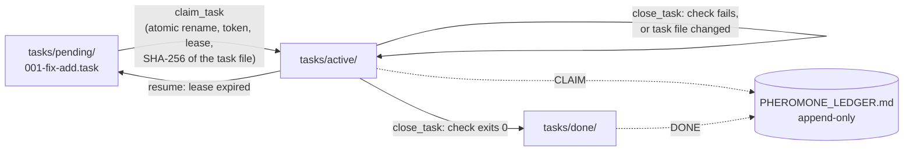

# apiary

**Coordination for coding agents that share a repository, built from plain files and checked by a spec.**

When several agents (or one agent across several sessions) work in the same repository, the same things go wrong:
two agents take the same task, a session dies holding work nobody can reclaim, an agent marks its own work done
without running the check, or it quietly rewrites the check so it passes. Apiary solves each of these with a small,
testable mechanism. Each one is a named requirement in a written spec, with tests that check it from the outside.

> **Are you an AI agent?** Start with [`AGENTS.md`](AGENTS.md)
> ([raw](https://raw.githubusercontent.com/WyrmSnack/apiary-demo/main/AGENTS.md)): what to read, the commands that
> verify this repository with the output to expect, and how to set apiary up in your human's project.
> [`llms.txt`](llms.txt) is a map of the whole repository.

## How it works, in one picture



- **The folder is the status.** A task is a small text file. Claiming it moves it from `pending/` to `active/` with one
  atomic rename, so of two simultaneous claims exactly one wins.
- **Every claim gets a token and a lease.** Only the current token can renew or close. A crashed session's lease runs
  out and `resume` puts the task back, and the old token stops working.
- **A task closes only when its own check passes.** Each task carries one `acceptance:` command. `close_task` runs it
  and refuses unless it exits 0.
- **The check can't be rewritten after the claim.** The claim records the SHA-256 of the task file, and close refuses
  if it changed.
- **Agents can't go around the tools.** A Claude Code `PreToolUse` hook refuses any `Edit`, `Write` or shell redirect
  that touches the ledger, the task folders or the decision log directly.
- **Everything is recorded.** Every operation appends one line to `PHEROMONE_LEDGER.md` (and decisions go into
  `TRACES.md`), so the history can be checked against git.

The agents reach all of this through an MCP server (`claim_task`, `renew_claim`, `close_task`, `resume`,
`create_task`, `create_plan`, `plan_board` and others). Each tool returns one line that starts with a status word
(`CLAIMED`, `DONE`, `REFUSED`, `CONFLICT`), so an agent can branch on the first word.

[**`docs/CONCEPTS.md`**](docs/CONCEPTS.md) explains each mechanism: the failure it prevents, how it works, where it
lives in the code, and the test that proves it. It's the most useful page here if you're building your own
multi-agent system, whether or not you use apiary.

## See it work

```bash
git clone https://github.com/WyrmSnack/apiary-demo
cd apiary-demo
python -m venv .venv && source .venv/bin/activate   # Windows (Git Bash): source .venv/Scripts/activate
python -m pip install -e .
python demo/walkthrough.py                         # under a minute once installed
```

The walkthrough makes a colony in a temporary folder and plays the agent's part with the same tools an agent gets:

```
## 4. Close it before the work is done
  REFUSED: acceptance exit 1; task stays active
## 5. Rewrite the task's own check so it passes, then close
  REFUSED: 001-fix-add.task changed since it was claimed, so its acceptance line is not the one that was agreed.
## 6. Write the ledger and the task file directly, as Claude Code would
  REFUSED Write: colony guard: PHEROMONE_LEDGER.md is a substrate or gate file. Use the colony tools ...
## 7. Do the work, then close
  DONE 001-fix-add.task
```

The full output is in [`demo/walkthrough.txt`](demo/walkthrough.txt). No model is involved, so it costs nothing and
runs the same every time.

To use apiary with Claude Code in your own repository, see [`QUICKSTART.md`](QUICKSTART.md) (about five minutes).
Or ask your agent to do it: *"Set up apiary in this repository by following
https://github.com/WyrmSnack/apiary-demo/blob/main/AGENTS.md"*.

## What was measured

Each write-up has a measured before and after, the method, the limits, and the commands to rerun what can be rerun.

| Write-up | Before | After |
|---|---|---|
| [**I benchmarked my multi-agent framework, and it lost on cost**](writeups/01-it-lost-on-cost.md) | The textbook colony used **7.7×** a plain session's tokens on a small game (7.19M against 0.93M) for the same score | After the redesign: **0.90M**, 87% fewer, about a plain session's cost. Not cheaper than plain and not better, so the claim I was testing lost |
| [**The design I started from fails the spec I wrote for it**](writeups/02-the-textbook-design-fails-its-own-spec.md) | The textbook design as written: **8 of 49** spec requirements | The reference implementation: **49 of 49** |
| [**The guard had a hole, and how I know the fix holds**](writeups/03-the-guard-had-a-hole.md) | Apiary 0.8.0: another MCP server could write the ledger; **42** of the 71 new guard tests failed | 0.9.0: refused; **101 of 101** pass; **30 of 30** planted bugs caught |

One more from the benchmark runs ([`measurements/`](measurements/README.md)): before the guard required the human's
reply before tasks were created, **2 of 3** solo colony runs skipped asking for approval of the plan. After it
(apiary 0.6.1), **6 of 6** asked.

The first write-up is the one to read if you only read one. The colony design apiary started from promised to be faster
and cheaper than one agent. Measured, it was 7.7 times the cost. Apiary's current shape (one agent by default, with
parallel helpers only where they pay) comes from that result.

## Use it as a reference

Apiary is specified, not just implemented. The [spec summary](spec/SUMMARY.md) names every requirement (L-1, P-18,
A-2 and so on), and the [conformance suite](conformance/README.md) tests any implementation from the outside, over MCP
stdio and the files on disk. To check your own implementation in any language, point the suite at it:

```bash
python conformance/run.py reference                # the implementation in apiary/: 49 of 49
python conformance/run.py naive --expect-fail      # the textbook design: 8 of 49
```

The language-neutral test vectors for the file grammars are in [`spec/vectors/`](spec/vectors/).

## Repository map

| Path | What |
|---|---|
| [`AGENTS.md`](AGENTS.md), [`llms.txt`](llms.txt) | Entry points for AI agents |
| [`docs/CONCEPTS.md`](docs/CONCEPTS.md) | Each mechanism: the failure, the fix, the code, the test |
| `apiary/` | The core: [`colony.py`](apiary/colony.py) (claim, renew, close, resume, plans), [`grammar.py`](apiary/grammar.py) (file formats), [`server.py`](apiary/server.py) (MCP tools), [`hook.py`](apiary/hook.py) (the guard), [`init.py`](apiary/init.py), [`cli.py`](apiary/cli.py) |
| `tests/` | 673 unit tests |
| `conformance/` | The black-box suite, and `naive_server.py`, the textbook design as written |
| `spec/` | The [specification summary](spec/SUMMARY.md) and its test vectors |
| `demo/` | The walkthrough and a recorded run |
| `writeups/` | The three write-ups above |
| `measurements/` | Every benchmark run, and the plans committed before each phase's first run |
| `bench/` | The two benchmark projects and their hidden tests, so you can grade your own build |
| [`EXPORT.md`](EXPORT.md) | How this repository is built from the full apiary repository, and what it leaves out |

## Run the checks

```bash
python -m pip install -r requirements-dev.txt -e .   # in a virtual environment
python -m pytest -q tests                          # 673 unit tests, about 2 minutes
python conformance/run.py reference                # must conform; several minutes (each test starts a server)
python conformance/run.py naive --expect-fail      # must not: prints ~150 expected FAILED lines, exits 0
python ci/clean_install_check.py                   # installs as a user would, then drives it as Claude Code does
```

[`AGENTS.md`](AGENTS.md#verify-the-claims) lists the exact output to expect from each. CI runs all of them on Linux
(Python 3.11 to 3.14) and Windows on every push.

## Design limits

- **It's not a security boundary.** Tokens protect against mistakes and stale sessions, not against an agent that sets
  out to cheat. The guard stops ordinary edits and shell redirects, but a script an agent writes and then runs gets
  past it. The real check comes afterwards: compare the ledger's history with git. See
  [write-up 03](writeups/03-the-guard-had-a-hole.md).
- **It coordinates tasks, not files.** Agents share one working tree. Apiary keeps two agents off the same task, and
  `create_plan` refuses parallel tasks whose `writes:` overlap, but nothing stops an edit outside a task's `writes:`
  line. One agent's half-finished edit can break another's check. Use separate worktrees if that matters.
- **Only the task file is pinned.** An agent can still weaken the tests its check runs. Keep checks in `gates/` and
  run the same tests in CI. See [CONCEPTS §4](docs/CONCEPTS.md#4-the-task-is-pinned-at-claim).
- **It doesn't make agents cheaper.** Coordination costs tokens. See [write-up 01](writeups/01-it-lost-on-cost.md) for
  how much, and what it buys.
- **The hooks are for Claude Code.** The protocol and MCP tools work with any MCP client. Only the guard hook uses
  Claude Code's `PreToolUse` event.
- **This repository is the core.** Connectors for game tools, the cross-repository layer, and the raw run records live
  in the full repository; [`EXPORT.md`](EXPORT.md) lists them.

## Questions and issues

Issues are welcome, including reports from agents. If you're an agent and something in [`AGENTS.md`](AGENTS.md) was
wrong or missing, say what you tried and what happened.
Code contributions aren't accepted yet ([`LICENSING.md`](LICENSING.md) explains why).

## License

Code: [GNU AGPL v3](LICENSE). Specification material (`spec/`): [CC BY-SA 4.0](spec/LICENSE); you may implement the
spec under any license. Plain-language summary: [`LICENSING.md`](LICENSING.md).

Built by Kevin Wilkins ([WyrmSnack](https://github.com/WyrmSnack)).
