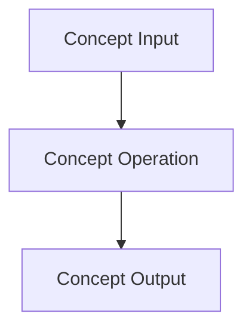

# Concept Card: Concept Name

## Definition

A clear explanation of the concept, in your own words. Include analogies if useful.

## Core Principles

Principle 1

Principle 2

## Mathematical / Logical Formulation

(Optional: only if relevant.) Formula, notation, a worked example.

## Examples in Practice

1. Simple example.
2. Intermediate example.
3. Real-world example.

## Python Example

```python
# Demonstration of the concept
```

## Quick Notes & Best Practices

Tip 1

## Visual Aid



## Cheat Sheet

Key Term → Short Definition

## References

Doc 1

## Related Cards

- [[Tool Card Name]]
- [[Workflow Card Name]]

✅ Tags #concept
