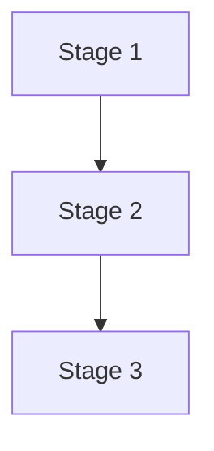

# Playbook Card: Playbook Name

## Definition

Concise definition of the playbook, the problem it solves, and where it fits end to end.

## Scope & Assumptions

In scope; out of scope; preconditions; success criteria.

## Architecture Overview

Components and how they interact.

## Constituent Cards

Workflows

- [[Workflow Card Name]]

Concepts

- [[Concept Card Name]]

Tools

- [[Tool Card Name]]

## End-to-End Pipeline Stages

### 1. Stage 1 Title

Workflows used; tools; outputs.

## Operational Runbook

Environments, configuration, versioning, failure modes and recovery.

## Quick Notes & Best Practices

Tip 1

## Visual Aid

## References

Doc 1

## Related Cards

- [[Workflow Card Name]]

✅ Tags #playbook
