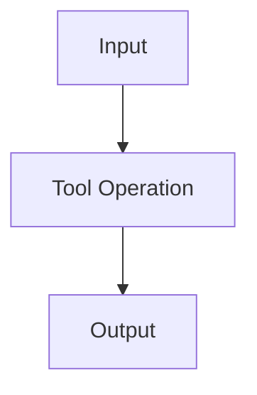

# Tool Card: Tool Name

## Definition

Concise definition of the tool, its primary purpose, and its typical roles.

## Installation & Setup

Installation command(s), versions, dependencies, quick start. If the colony has a connector for it, say so
(`connectors/<name>.toml`) and how to run it with `run_connector`.

## Core Capabilities

Capability 1

## Limitations & Gotchas

Limitation 1

## Common Operations (API / CLI)

1. Operation 1: inputs, outputs, example.

## Python Example

```python
# Minimal usage example
```

## Command-Line Example

```
tool ... --flag value
```

## Interoperability

Works well with, supported formats, integration patterns.

## Performance & Scaling

Memory and CPU, parallelism, batch versus streaming.

## Quick Notes & Best Practices

Tip 1

## Visual Aid



## References

Doc 1

## Related Cards

- [[Concept Card Name]]
- [[Workflow Card Name]]

✅ Tags #tool
