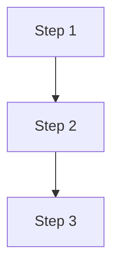

# Workflow Card: Workflow Name

## Definition

Concise definition of the workflow, why it exists, and where it fits.

## Typical Pipeline Stages

### 1. Stage 1 Title

Inputs and sources; tools and libraries; outputs.

### 2. Stage 2 Title

…

## Python Workflow (Code Example)

```python
# Step 1: Setup
# Step 2: Core task
# Step 3: Output
```

## Quick Notes & Best Practices

Tip 1

## Visual Aid



## References

Doc 1

## Related Cards

- [[Tool Card Name]]
- [[Concept Card Name]]

✅ Tags #workflow
